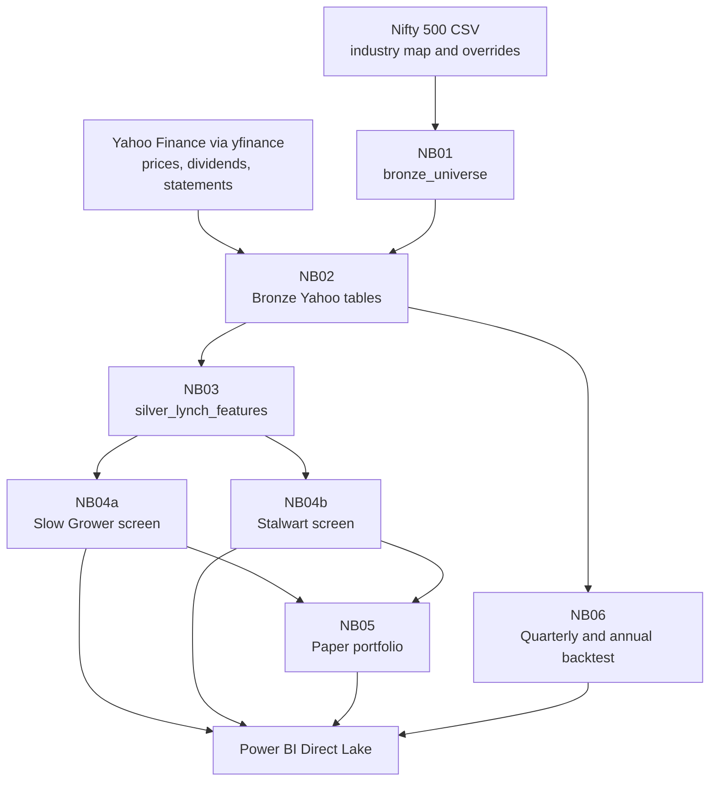

# Lynch Slow Grower & Stalwart Screener — Microsoft Fabric

A research prototype built on **Microsoft Fabric** that ingests Yahoo Finance data, calculates Peter Lynch-inspired metrics, and runs two separate screens:

- **Slow Growers**: a dividend-first screen for high, repeated, and financially supported dividends.
- **Stalwarts**: a growth-plus-valuation screen for durable earnings growth bought with valuation discipline.

**Tech stack:** PySpark · Delta Lake · Yahoo Finance via `yfinance` · Power BI Direct Lake

> **Disclaimer:** Research and paper-portfolio prototype only. Not investment advice. Not a live trading system. No broker is connected and no real orders are placed.

---

## Contents

- [What Has Been Implemented](#what-has-been-implemented)
- [Architecture](#architecture)
- [Data Ingestion From Yahoo Finance](#data-ingestion-from-yahoo-finance)
- [Tables](#tables)
- [Notebook Workflow](#notebook-workflow)
- [Slow Grower Methodology](#slow-grower-methodology)
- [Stalwart Methodology](#stalwart-methodology)
- [Key Calculated Metrics](#key-calculated-metrics)
- [Paper Portfolio](#paper-portfolio)
- [Backtesting Design](#backtesting-design)
- [Power BI](#power-bi)
- [Configuration Files](#configuration-files)
- [Repository Structure](#repository-structure)
- [Setup and Run Order](#setup-and-run-order)
- [Validation Queries](#validation-queries)
- [Limitations](#limitations)
- [Disclaimer](#disclaimer)

---

## What Has Been Implemented

1. Nifty 500 universe classification using an industry-to-bucket mapping and manual symbol overrides.
2. Yahoo Finance ingestion at notebook runtime for:
   - daily prices,
   - dividend history,
   - annual and quarterly financial statements,
   - market snapshot data.
3. Silver feature calculation for earnings growth, profitability, leverage, cash flow, dividends, valuation, and data coverage.
4. Two separate Gold screens with separate configuration files and notebooks:
   - `NB04a_Slow_Growers`
   - `NB04b_Stalwarts`
5. A simulated paper portfolio configured with **Rs. 10,00,000** starting capital.
6. A separate backtest notebook that runs Slow Grower and Stalwart screens differently and compares:
   - Slow Grower vs. Stalwart,
   - quarterly screens vs. annual screens.
7. Power BI reporting specification using Direct Lake on OneLake.

> Fast Growers are not part of this project. They require a different thesis and different risk rules.

---

## Architecture



---

## Data Ingestion From Yahoo Finance

Yahoo Finance has no official public API for this use case. The project uses the unofficial `yfinance` Python library inside Fabric notebooks.

For each in-scope `.NS` ticker, NB02 requests:

| Yahoo call | Data stored | Main use |
|---|---|---|
| `Ticker.history()` | Open, High, Low, Close, Adj Close, Volume | Prices, returns, valuation, backtest entry/exit |
| `Ticker.dividends` | Dividend amount and ex-date history | Yield, dividend years, no-cut checks, dividend accrual |
| `Ticker.info` / `fast_info` | Market cap, shares, sector metadata | Market snapshot |
| `income_stmt`, `balance_sheet`, `cashflow` | Annual statements | EPS, ROE, debt, cash flow, capex |
| `quarterly_income_stmt`, `quarterly_balance_sheet`, `quarterly_cashflow` | Quarterly statements | TTM EPS and quarterly checks |

Data is fetched when the notebook runs. Yahoo prices may be delayed during market hours. Financial statements update only after companies publish results. This is not a real-time streaming feed.

NB02 stores Yahoo statements in long format:

```text
symbol, yahoo_symbol, period_type, statement_type,
period_end, source_field, value, ingested_at, run_id
```

This format is used so Yahoo field-name changes do not require a wide-table schema migration.

---

## Tables

### Bronze

| Table | Contents | Written by |
|---|---|---|
| `bronze_universe` | Nifty 500 symbols, industry, bucket, `in_scope`, `rule_set` | NB01 |
| `bronze_yahoo_prices` | Daily OHLCV and adjusted close | NB02 |
| `bronze_yahoo_dividends` | Available dividend history | NB02 |
| `bronze_yahoo_fundamentals_long` | Annual and quarterly Yahoo statements in long format | NB02 |
| `bronze_yahoo_market_snapshot` | Current market cap, shares, price and sector metadata | NB02 |
| `bronze_yahoo_ingestion_log` | Attempted, successful and failed symbols per run | NB02 |

### Silver

| Table | Contents | Written by |
|---|---|---|
| `silver_lynch_features` | One current feature row per in-scope company: growth, ROE, leverage, coverage, cash flow, dividend, valuation, provisional category and data-status fields | NB03 |

### Gold: screening

| Table | Contents | Written by |
|---|---|---|
| `gold_slow_grower_screen` | Every screened stock with Slow Grower BUY/WATCH status and reason | NB04a |
| `gold_slow_grower_candidates` | Ranked Slow Grower BUY list | NB04a |
| `gold_stalwart_screen` | Every screened stock with Stalwart BUY/WATCH status and reason | NB04b |
| `gold_stalwart_candidates` | Ranked Stalwart BUY list | NB04b |

There is no combined candidate table in the current design. NB05 reads the two split candidate tables.

### Gold: paper portfolio

| Table | Contents | Written by |
|---|---|---|
| `gold_lynch_portfolio` | Current simulated holdings marked to the latest available price | NB05 |
| `gold_lynch_cash` | Simulated cash balance | NB05 |
| `gold_lynch_transactions` | Simulated BUY and DIVIDEND events | NB05 |

### Backtest

| Table | Contents | Written by |
|---|---|---|
| `backtest_qtr_trades` | Simulated trades from quarterly and annual screens | NB06 |
| `backtest_qtr_screens` | Screen date, screen type, universe size and pick counts | NB06 |
| `backtest_qtr_summary` | Summary by style and screen type | NB06 |
| `backtest_style_summary` | Overall style summary | NB06 |
| `backtest_screen_type_comparison` | Quarterly vs. annual comparison by style | NB06 |

---

## Notebook Workflow

| Notebook | Role | Main inputs | Main outputs |
|---|---|---|---|
| `NB01_Universe` | Classifies the Nifty 500 universe into buckets | Nifty 500 CSV, industry map, overrides | `bronze_universe` |
| `NB02_Yahoo_Bronze_Ingestion` | Downloads Yahoo prices, dividends, statements and market snapshot | `bronze_universe`, config | Bronze Yahoo tables |
| `NB03_Lynch_Silver_Features` | Calculates Lynch-inspired metrics and provisional categories | Bronze Yahoo tables | `silver_lynch_features` |
| `NB04a_Slow_Growers` | Dividend-first Slow Grower screen | Silver features, slow-grower config | Slow Grower Gold tables |
| `NB04b_Stalwarts` | Growth-plus-valuation Stalwart screen | Silver features, stalwart config | Stalwart Gold tables |
| `NB05_Paper_Portfolio` | Simulates buys, tracks holdings, marks to market and accrues dividends | Split candidate tables, prices, dividends | Paper portfolio Gold tables |
| `NB06_Quarterly_Backtest_v2` | Backtests both styles separately on quarterly and annual screens | Bronze prices, dividends and fundamentals | Backtest tables |

Recurring order:

```text
NB01 -> NB02 -> NB03 -> NB04a -> NB04b -> NB05
```

NB06 is run on demand for historical analysis. It is not part of the recurring paper-portfolio flow.

---

## Slow Grower Methodology

Slow Growers are screened as **dividend businesses first**. Growth is not the primary reason to select them.

**Primary question:** Is the dividend high, repeated, and supported by a healthy business?

Default gates are stored in `slow_grower_parameters.csv`. The current implemented checks include:

| Check | Default intent |
|---|---|
| TTM dividend yield | At least 3% |
| Dividend history | At least 5 dividend years in the measured window |
| Dividend cut check | No cut in the last 5 observable fiscal years when required |
| FCF payout | Dividends / free cash flow at or below 80% |
| Debt-to-equity | At or below 0.75 |
| Interest coverage | At least 4.0x |
| Minimum ROE | At least 10% |
| EPS CAGR cap | At or below 12%, so faster growers are not forced into this screen |
| P/E cap | At or below 50 |

Slow Grower candidates are ranked using dividend yield, dividend history, payout safety and leverage metrics.

Slow Growers do **not** use dividend-adjusted PEG as a hard gate. PEG becomes unstable when earnings growth is close to zero, which is common for mature dividend companies.

---

## Stalwart Methodology

Stalwarts are screened as **durable growth bought with valuation discipline**.

**Primary question:** Is earnings growth consistent, cash-backed and not overpriced relative to its own history and growth?

Default gates are stored in `stalwart_parameters.csv`. The current implemented checks include:

| Check | Default intent |
|---|---|
| Market cap | At least Rs. 5,000 Cr |
| EPS CAGR | 8% to 16% |
| Minimum ROE | At least 12% |
| Debt-to-equity | At or below 0.50 |
| Interest coverage | At least 5.0x |
| OCF / Net Income | At least 0.80 |
| P/E vs. own median | At or below 1.5x |
| P/E vs. peer median | At or below 1.3x |
| Dividend-adjusted PEG | At or above the configured minimum |

Stalwart candidates are ranked using dividend-adjusted PEG, valuation versus own history, and earnings growth.

### Dividend-adjusted PEG definition

This project calculates Lynch-style dividend-adjusted PEG as:

```text
dividend_adjusted_peg = (EPS growth % + TTM dividend yield %) / P/E
```

**Higher is better.** It is not Yahoo's PEG field, and it must not be inverted.

---

## Key Calculated Metrics

| Metric | Calculation used in the project |
|---|---|
| EPS CAGR | Latest annual EPS versus EPS three annual intervals earlier, requiring positive endpoints |
| Annual ROE | Net Income / Equity for matched annual periods |
| Minimum ROE | Minimum annual ROE across the available recent periods |
| Debt-to-equity | Total Debt / Equity |
| Interest coverage | EBIT / absolute Interest Expense |
| OCF/NI | Cumulative Operating Cash Flow / cumulative Net Income on matched periods |
| FCF payout | Absolute dividends paid / free cash flow |
| TTM dividend yield | Dividends with ex-date in the last 365 days / latest close |
| Own median yield | Median of fiscal-year DPS divided by price near fiscal year-end over available history |
| Current P/E | Price / TTM EPS when four valid quarters exist; otherwise price / latest annual EPS, labelled in `pe_basis` |
| Own median P/E | Median of annual EPS-based P/E values over available annual history |
| Peer P/E | Current P/E compared with the industry median P/E |

Missing metrics are kept as nulls and reported through data-status and reason fields. They are not silently converted into invented values.

---

## Paper Portfolio

NB05 simulates a paper portfolio with:

| Rule | Current design |
|---|---|
| Starting capital | Rs. 10,00,000 |
| Candidate sources | Latest Slow Grower and Stalwart candidate tables |
| Stale-data protection | Candidate screen date is checked against the corresponding screen table |
| Duplicate protection | A symbol appearing in both lists is bought only once |
| Existing holdings | Preserved across runs |
| New buys | Only symbols not already held |
| Position cap | Configured percentage of account value |
| Industry cap | Configured maximum holdings per industry |
| Price used | Latest available close from Bronze prices |
| Dividends | Accrued once per symbol and ex-date after the simulated buy date |
| Automated sells | Not included in the current NB05 version |

The paper portfolio is a simulation only. It does not model real order execution, order-book liquidity, slippage, brokerage, taxes or market impact.

---

## Backtesting Design

NB06 backtests Slow Growers and Stalwarts **separately**, because their entry logic and success measures are different.

### Slow Grower backtest focus

- Dividend yield and dividend consistency
- Dividend safety and leverage
- Price return plus dividend income
- Dividend-cut and wide stop-loss behaviour

### Stalwart backtest focus

- Annual EPS growth
- Quarterly EPS and sales YoY where available
- ROE, leverage and cash-flow quality
- P/E versus own history
- Dividend-adjusted PEG
- Growth or valuation deterioration

### Comparison outputs

The backtest writes separate trade and summary tables and a comparison table for:

```text
Slow Grower vs. Stalwart
Quarterly screens vs. annual screens
```

Point-in-time snapshots use only statement periods available before the screen date after an assumed publication lag. Entry and exit prices are taken from the Bronze price table. Transaction cost is configurable.

No backtest performance results are published in this README. Inspect the backtest tables after a run and read the [limitations](#limitations) below before interpreting them.

---

## Power BI

The reporting layer uses **Direct Lake on OneLake**.

Semantic model tables include:

- `gold_slow_grower_screen`
- `gold_slow_grower_candidates`
- `gold_stalwart_screen`
- `gold_stalwart_candidates`
- `gold_lynch_portfolio`
- `gold_lynch_cash`
- `gold_lynch_transactions`
- `silver_lynch_features`
- `bronze_universe`
- `bronze_yahoo_ingestion_log`
- `backtest_qtr_trades`
- `backtest_qtr_screens`
- `backtest_screen_type_comparison`

No manual relationships are created in the semantic model for the current report design. Visuals and measures use fields from the relevant tables directly or through DAX filters.

Report pages:

| Page | Purpose |
|---|---|
| Slow Growers | Dividend candidates, yield, dividend years, payout, debt and watch reasons |
| Stalwarts | Growth candidates, EPS CAGR, ROE, P/E, own-median P/E and PEG |
| Paper Portfolio | Simulated cash, holdings, unrealized P&L and dividend events |
| Data Quality | Ingestion status, coverage and rejection reasons |
| Backtest Comparison | Quarterly vs. annual and Slow Grower vs. Stalwart comparison |

---

## Configuration Files

| File | Used by |
|---|---|
| `Files/config/lynch_parameters.csv` | NB02, NB03, NB05 and backtest parameters |
| `Files/config/slow_grower_parameters.csv` | NB04a Slow Grower gates |
| `Files/config/stalwart_parameters.csv` | NB04b Stalwart gates |
| `Files/config/industry_classification.csv` | NB01 industry-to-bucket mapping |
| `Files/config/symbol_overrides.csv` | NB01 manual symbol classification overrides |
| `Files/reference/nifty500_raw.csv` | NB01 universe input |

Configuration files are authoritative. If this README and a config value differ, the config file and notebook code win.

---

## Repository Structure

```text
lynch-slow-grower-stalwart-fabric/
├── README.md
├── .gitignore
├── notebooks/
│   ├── NB01_Universe.ipynb
│   ├── NB02_Yahoo_Bronze_Ingestion.ipynb
│   ├── NB03_Lynch_Silver_Features.ipynb
│   ├── NB04a_Slow_Growers.ipynb
│   ├── NB04b_Stalwarts.ipynb
│   ├── NB05_Paper_Portfolio.ipynb
│   └── NB06_Quarterly_Backtest_v2.ipynb
├── config/
│   ├── lynch_parameters.csv
│   ├── slow_grower_parameters.csv
│   ├── stalwart_parameters.csv
│   ├── industry_classification.csv
│   └── symbol_overrides.csv
├── docs/
│   ├── ARCHITECTURE.md
│   ├── METHODOLOGY.md
│   ├── SETUP_GUIDE.md
│   └── LIMITATIONS.md
├── pipeline/
│   └── PIPELINE_CONFIG.md
├── powerbi/
│   └── dax_measures.md
└── images/
```

Only include screenshots and exported notebooks that actually exist in the repository. Do not commit Lakehouse data exports, credentials, tokens or personal holdings.

---

## Setup and Run Order

1. Create a Fabric workspace and Lakehouse for this project.
2. Create a Fabric Environment with `yfinance` available.
3. Upload the reference and config files to the Lakehouse Files area.
4. Attach the Lakehouse and Environment to every notebook.
5. Run notebooks in this order:

   ```text
   NB01 -> NB02 -> NB03 -> NB04a -> NB04b -> NB05
   ```

6. Run `NB06_Quarterly_Backtest_v2` separately when historical analysis is needed.
7. Create the Power BI semantic model using Direct Lake on OneLake.

> Do not use inline `%pip install` inside pipeline notebooks. Install libraries through the Fabric Environment.

---

## Validation Queries

**Universe buckets**

```sql
SELECT bucket, COUNT(*) AS companies
FROM bronze_universe
GROUP BY bucket
ORDER BY companies DESC;
```

**Silver data status and provisional categories**

```sql
SELECT data_status, category_provisional, COUNT(*) AS stocks
FROM silver_lynch_features
GROUP BY data_status, category_provisional
ORDER BY data_status, stocks DESC;
```

**Slow Grower BUY vs. WATCH**

```sql
SELECT final_status, COUNT(*) AS stocks
FROM gold_slow_grower_screen
GROUP BY final_status;
```

**Stalwart BUY vs. WATCH**

```sql
SELECT final_status, COUNT(*) AS stocks
FROM gold_stalwart_screen
GROUP BY final_status;
```

**Candidate counts**

```sql
SELECT COUNT(*) AS slow_candidates FROM gold_slow_grower_candidates;
SELECT COUNT(*) AS stalwart_candidates FROM gold_stalwart_candidates;
```

**Paper cash reconciliation**

```sql
SELECT cash_balance FROM gold_lynch_cash;

SELECT COALESCE(SUM(market_value), 0) AS invested
FROM gold_lynch_portfolio
WHERE quantity > 0;
```

---

## Limitations

- Yahoo Finance access through `yfinance` is unofficial. Field names, coverage and availability can change.
- Yahoo prices may be delayed. This project is not a real-time trading feed.
- Annual financial statement depth varies by symbol. EPS classification is therefore provisional.
- Dividend and price history are longer than statement history, but coverage still varies by company.
- The project uses period-end dates plus an assumed publication lag. It does not have exact historical filing timestamps for every statement.
- The universe is based on the current Nifty 500 constituent list, so historical analysis has survivorship bias.
- Historical market-cap reconstruction can require approximations when historical shares are unavailable.
- Quarterly fundamental coverage is uneven, especially for older quarters.
- Consecutive backtest screens can hold overlapping positions, so trades are not fully independent observations.
- Paper trades use available closing prices and do not represent guaranteed executable prices.
- The current NB05 version records simulated buys and dividend events. Automated sell logic is not included.
- Lynch categories in this project are quantitative proxies. Industry dynamics, management quality, competitive position and hidden asset value require manual research and are not fully measured by the notebooks.

---

## Disclaimer

This repository is for educational and research purposes only. It is not financial advice, not a live brokerage system and not a promise of investment performance. The paper-trading component does not place real orders. Historical backtest results are exploratory and do not predict future returns.
