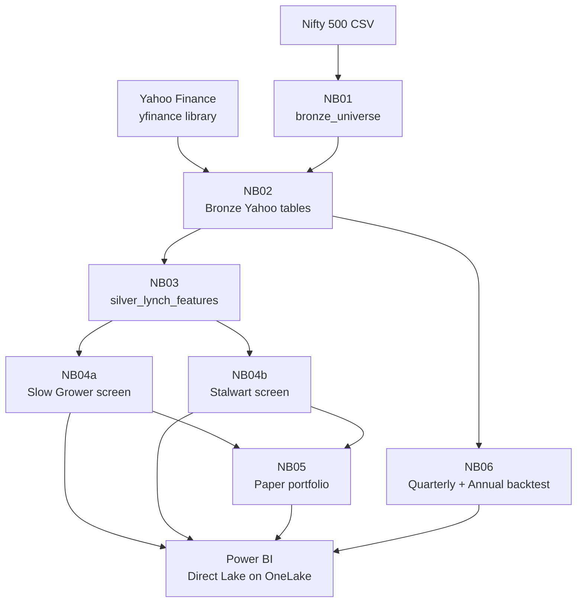
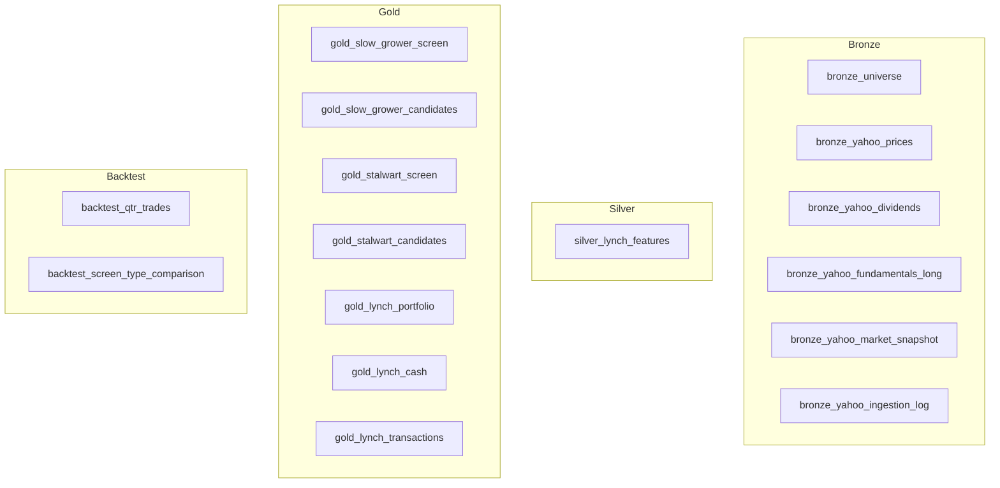

# Architecture

System design for the Lynch Slow Grower & Stalwart Screener on Microsoft Fabric.

> Research and paper-portfolio prototype only. Not investment advice.

## Overview

The system ingests Yahoo Finance data into a Medallion Architecture (Bronze → Silver → Gold), calculates Lynch-inspired metrics, runs two separate category-specific screens, simulates a paper portfolio, and backs up results with a comparative backtest. Power BI consumes the Gold and Backtest tables through Direct Lake on OneLake.

## Data Flow



## Medallion Layers

### Bronze — raw source data

| Table | Source | Written by |
|---|---|---|
| `bronze_universe` | Nifty 500 CSV + industry map + symbol overrides | NB01 |
| `bronze_yahoo_prices` | `Ticker.history()` per in-scope `.NS` symbol | NB02 |
| `bronze_yahoo_dividends` | `Ticker.dividends` per in-scope symbol | NB02 |
| `bronze_yahoo_fundamentals_long` | `income_stmt`, `balance_sheet`, `cashflow` and quarterly variants in long format | NB02 |
| `bronze_yahoo_market_snapshot` | `Ticker.info` / `fast_info` metadata | NB02 |
| `bronze_yahoo_ingestion_log` | Per-run success, failure and row-count log | NB02 |

Bronze tables preserve the source response shape. Fundamentals are stored in long format (`symbol, period_type, statement_type, period_end, source_field, value`) so Yahoo field-name changes do not require a wide-table schema migration.

### Silver — one cleaned feature row per in-scope company

| Table | Written by |
|---|---|
| `silver_lynch_features` | NB03 |

Silver calculates annual and quarterly growth, profitability, leverage, coverage, cash-flow quality, dividend metrics, valuation metrics, provisional categories, and data-coverage status. Missing data is kept as null and surfaced through status and reason columns. It is never converted into a silent pass.

### Gold — screening and portfolio outputs

| Table | Written by | Purpose |
|---|---|---|
| `gold_slow_grower_screen` | NB04a | Every stock: Slow Grower BUY / WATCH + reason |
| `gold_slow_grower_candidates` | NB04a | Ranked Slow Grower BUY list |
| `gold_stalwart_screen` | NB04b | Every stock: Stalwart BUY / WATCH + reason |
| `gold_stalwart_candidates` | NB04b | Ranked Stalwart BUY list |
| `gold_lynch_portfolio` | NB05 | Current simulated holdings, marked to latest price |
| `gold_lynch_cash` | NB05 | Simulated cash balance |
| `gold_lynch_transactions` | NB05 | Appended BUY and DIVIDEND events |

There is no combined candidate table. NB05 and Power BI read the two split candidate tables independently.

### Backtest

| Table | Written by | Purpose |
|---|---|---|
| `backtest_qtr_trades` | NB06 | Every simulated trade (quarterly + annual screens) |
| `backtest_qtr_screens` | NB06 | Per-screen summary (date, type, universe size, picks) |
| `backtest_qtr_summary` | NB06 | Summary by style and screen type |
| `backtest_style_summary` | NB06 | Overall style summary across all screens |
| `backtest_screen_type_comparison` | NB06 | Quarterly vs. annual comparison by style |

## Notebook Dependencies

```text
NB01_Universe
  └── NB02_Yahoo_Bronze_Ingestion
        └── NB03_Lynch_Silver_Features
              ├── NB04a_Slow_Growers
              │     └── NB05_Paper_Portfolio
              ├── NB04b_Stalwarts
              │     └── NB05_Paper_Portfolio
              └── NB06_Quarterly_Backtest_v2  (on demand)
```

NB04a and NB04b both read Silver and run independently. NB05 reads both candidate tables with a staleness check against their corresponding screen tables. NB06 is run on demand for historical analysis and is not part of the recurring flow.

## Configuration Files

| File | Used by |
|---|---|
| `Files/config/lynch_parameters.csv` | NB02, NB03, NB05, NB06 |
| `Files/config/slow_grower_parameters.csv` | NB04a |
| `Files/config/stalwart_parameters.csv` | NB04b |
| `Files/config/industry_classification.csv` | NB01 |
| `Files/config/symbol_overrides.csv` | NB01 |
| `Files/reference/nifty500_raw.csv` | NB01 |

## Design Decisions

1. **Two screens, not one.** Slow Growers are dividend-first. Stalwarts are growth-plus-valuation. They use different configs, notebooks, and Gold tables because their theses require different gates.

2. **Long-format fundamentals.** Storing Yahoo statements as `(symbol, period_type, statement_type, period_end, source_field, value)` survives Yahoo field-name changes without schema migration.

3. **Missing data never passes.** A null ROE, D/E, yield, or payout fails the gate with an explicit reason. It is never treated as a pass or silently defaulted.

4. **PEG direction is fixed.** `dividend_adjusted_peg = (growth% + yield%) / P/E`, higher is better. Stalwart gate is `>= minimum`. Slow Growers have no PEG hard gate because PEG is unstable near zero growth.

5. **No silent overwrites.** NB02 refuses to overwrite prices with an empty download. NB02 preserves fundamentals unless enough symbols succeed. NB05 never buys from stale candidate tables.

6. **Cash survives empty portfolio.** Cash lives in `gold_lynch_cash`, not inside portfolio-row columns, so an empty candidate screen never wipes the cash balance.

7. **Paper portfolio is buy-and-track.** Current NB05 records buys, accrues dividends, and marks holdings to market. Automated sell logic is not included in this version.

8. **Backtest is separate from live flow.** NB06 runs on demand and writes to its own table set. It does not interfere with the recurring paper-portfolio pipeline.

## Platform

| Component | Choice |
|---|---|
| Compute and storage | Microsoft Fabric Lakehouse |
| Processing | PySpark Notebooks |
| Table format | Delta Lake on OneLake |
| Data source | Yahoo Finance via `yfinance` (unofficial library) |
| Reporting | Power BI with Direct Lake on OneLake |
| Environment | Fabric Environment with `yfinance` installed |

## Diagram Legend


